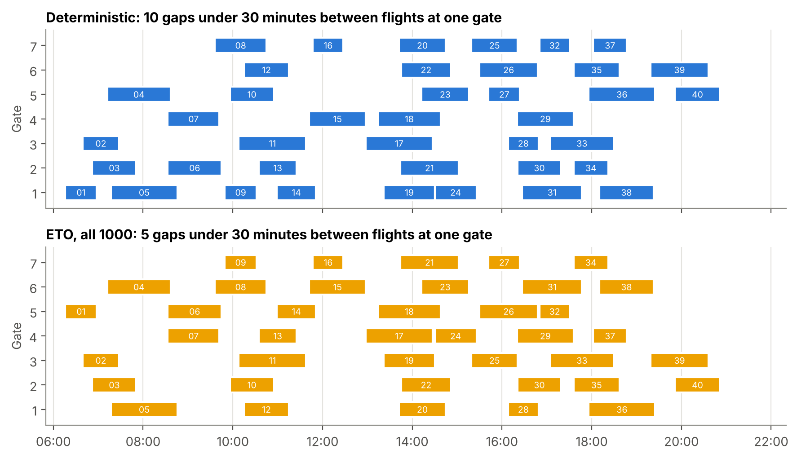

# Airline gate assignment under flight delays

**Machine-learning delay scenarios + a stochastic mixed-integer model in Gurobi**

An airport has 7 contact gates and 40 flights to place on a Friday with thunderstorms forecast.
If a flight lands late, it can still be at its gate when the next aircraft arrives: a **gate conflict**.
This project learns delays from 120 past days, turns the forecast into 1,000 possible versions of the day,
and builds a gate plan with a mixed-integer model that keeps the expected number of conflicts low.
Every plan is then scored on 300 simulated days that no model has seen.



## Result

| Plan | Conflicts per day | Days without conflict |
|---|---|---|
| Deterministic (timetable only) | 0.66 | 53% |
| Predict-then-optimise (point forecast) | 3.67 | 5% |
| Estimate-then-optimise, 20 k-means scenarios | 0.23 | 79% |
| **Estimate-then-optimise, all 1,000 scenarios** | **0.12** | **88%** |

Planning on all 1,000 scenarios gives 81% fewer conflicts than the timetable plan.
Planning on the point forecast is worst: the forecast shrinks the planned ground times, so the model packs flights too tightly.
No plan needed the apron, and every model was solved to optimality.

## Method in four steps

| Step | File | What it does |
|---|---|---|
| 1 | `step1_predict.py` | **Supervised learning.** Predicts each flight's arrival delay; compares a weather average, linear regression and gradient boosting with 5-fold cross-validation grouped by day. |
| 2 | `step2_scenarios.py` | **Scenarios.** Forecast plus resampled forecast errors gives 1,000 possible days; **k-means** picks 20 representative ones. |
| 3 | `step3_optimize.py` | **Optimisation.** Stochastic gate assignment model (after Şeker & Noyan, 2012): clique constraints, pair filtering and an exact aggregation of the scenarios. With 1,000 scenarios it has 427 variables and 922 constraints and solves in a few seconds. |
| 4 | `step4_evaluate.py` | Counts conflicts of each plan on 300 unseen days; paired bootstrap confidence intervals. |

Other files: `settings.py` (all numbers in one place), `make_data.py` (synthetic data), `main.py` (runs steps 1 to 4),
`experiments.py` (computational study), `figures.py` (figures in `results/figures/`).
The full write-up is in `report.docx`.

## The model

For flights $i$, contact gates $g$, the apron $A$, the maximal cliques $\mathcal{C}$ of flights on the ground together in the timetable,
and the pairs $P$ that can come too close in some scenario:

$$\min \sum_{(i,j) \in P} w_{ij}\, y_{ij} + 60 \sum_{i} x_{iA}$$

subject to

$$\sum_{g} x_{ig} + x_{iA} = 1 \quad \forall i, \qquad \sum_{i \in Q} x_{ig} \le 1 \quad \forall Q \in \mathcal{C},\ g,$$

$$y_{ij} \ge x_{ig} + x_{jg} - 1 \quad \forall (i,j) \in P,\ g, \qquad x \in \{0,1\},\ 0 \le y \le 1 .$$

The weight $w_{ij} = \sum_{\omega} p_\omega \left(100 \cdot [\text{overlap}] + 1 \cdot [\text{gap} < 15\ \text{min}]\right)$
is the expected cost of flights $i$ and $j$ sharing a gate, computed once over all scenarios before Gurobi runs.

## Data

The data in `data/` are synthetic, made by `make_data.py` with a fixed seed, so they are the same on every computer.
Every random part follows a named distribution:

| Part of the data | Distribution |
|---|---|
| Arrival times | Poisson process, 2.7 flights per hour from 06:00 |
| Scheduled ground time | Discrete uniform, 40 to 90 minutes |
| Airline, weather of a past day | Categorical |
| Day shock (shared by all flights of a day) | Normal, mean 0, SD 10 minutes |
| Own delay of each flight | Gamma (shape 2, scale 6) minus 12 |

| File | Rows | Content |
|---|---|---|
| `history.csv` | 4,800 | 120 past days × 40 flights, with weather and observed arrival delay |
| `test_day.csv` | 40 | The day to plan: Friday (`day_of_week = 4`), thunderstorms (`weather = 2`) |
| `test_outcomes.csv` | 12,000 | 300 possible outcomes of that day, used only for scoring |

Times are minutes after midnight. Weather: 0 = fine, 1 = rain, 2 = thunderstorms.

## Run it

Python 3.10 to 3.13.

```bash
python -m venv .venv
source .venv/bin/activate          # Windows: .venv\Scripts\Activate.ps1
pip install -r requirements.txt

python main.py          # steps 1-4, result table and the gate plans (under half a minute)
python experiments.py   # computational study (a few minutes)
python figures.py       # figures in results/figures/
```

`pip install gurobipy` includes a free licence for models up to 2,000 variables and constraints, which is enough for `main.py`.
In `experiments.py`, the original scenario-indexed model outgrows that licence from 50 scenarios on; an academic licence solves those rows too.

`results/` holds our own run (Gurobi 13.0.3, academic licence). The models can have several optimal plans with the same cost,
so on another computer a gate plan can look different while the costs and the result table stay the same.

### Plan another day

Edit two lines in `make_data.py`: the line with `day_of_week=4, weather=2` (the day to plan) and the line with
`np.full(N_TEST_DAYS, 2), np.full(N_TEST_DAYS, 4)` (the 300 test days, weather first, weekday second).
Weekdays are 0 = Monday to 6 = Sunday, so a rainy Tuesday is `day_of_week=1, weather=1`. Then run `python make_data.py` and `python main.py`.

## References

- Şeker, M., & Noyan, N. (2012). Stochastic optimization models for the airport gate assignment problem. *Transportation Research Part E, 48*(2), 438–459. https://doi.org/10.1016/j.tre.2011.10.008
- Zhang, C., Jin, Z., Ng, K. K. H., Tang, T.-Q., Zhang, F., & Liu, W. (2025). Predictive and prescriptive analytics for robust airport gate assignment planning in airside operations under uncertainty. *Transportation Research Part E, 195*, 103963. https://doi.org/10.1016/j.tre.2025.103963
- Elmachtoub, A. N., & Grigas, P. (2022). Smart "predict, then optimize". *Management Science, 68*(1), 9–26. https://doi.org/10.1287/mnsc.2020.3922
